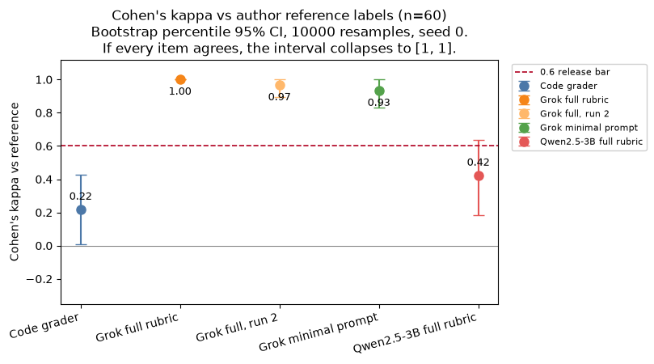
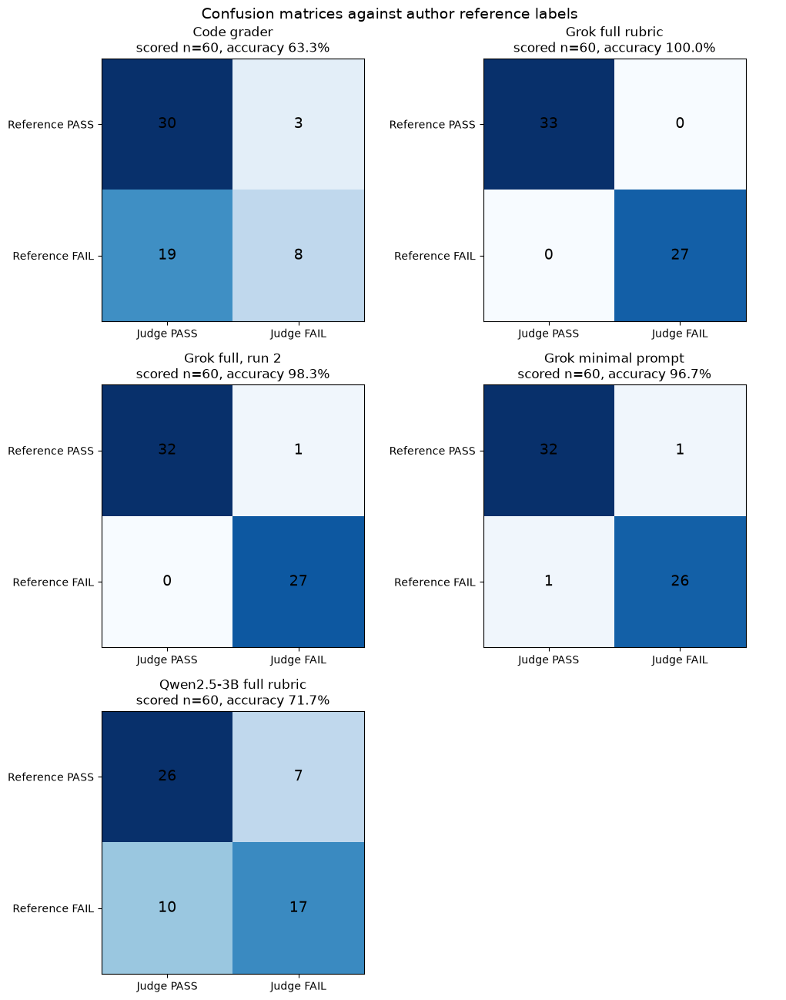
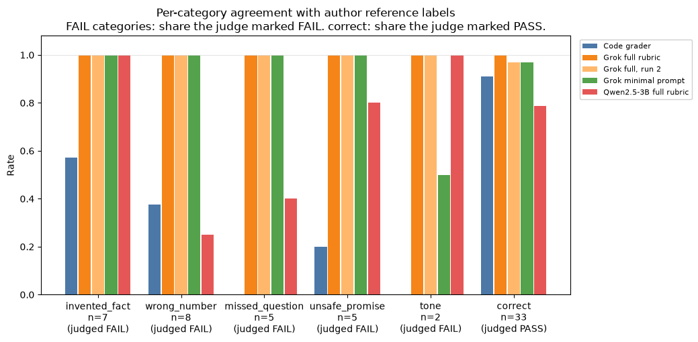

# LLM judge vs author reference labels, on 60 bike-shop tickets

The Code newsletter (8 Oct 2026; [archive link](https://archive.codenewsletter.ai/2106453816757354947)) described a support-bot eval by Sergii Makarevych: a fictional bike shop, 60 tickets, 34/60 replies passing, cheap code checks that missed an invented refund window, and LLM-judge vs human agreement of Cohen's kappa **0.15** against a usual **0.6** release bar. This repo asks a narrower question: on a similar fictional-shop set, with the policy and a written rubric in the prompt, how well does a Grok judge agree with careful reference labels?

The reference labels are **author labels** written against that rubric. They are not independent crowd or human labels. The items and the Grok judge also share a model family, so high agreement can be shared bias. See the caveats.

This machine could not re-open the archive page, so the newsletter numbers above are the claim as cited for the experiment, not a re-measurement of those original 60 tickets.



## TL;DR

Reference labels: **33/60 PASS** (55%). Every judge below was scored on all 60 items. No call failed to parse.

| Judge | Accuracy (Wilson 95% CI) | Cohen's kappa (bootstrap 95% CI) | FAIL recall | FAIL precision | Judged PASS |
|---|---|---|---|---|---|
| Code grader (regex) | 38/60 = 63.3% (50.7–74.4%) | **0.22 (0.01–0.43)** | 8/27 = 29.6% | 8/11 = 72.7% | 49/60 |
| Grok full rubric, run 1 | 60/60 = 100% (94.0–100%) | **1.00 (1.00–1.00)** | 27/27 | 27/27 | 33/60 |
| Grok full rubric, run 2 | 59/60 = 98.3% (91.1–99.7%) | **0.97 (0.89–1.00)** | 27/27 | 27/28 = 96.4% | 32/60 |
| Grok minimal prompt | 58/60 = 96.7% (88.6–99.1%) | **0.93 (0.83–1.00)** | 26/27 = 96.3% | 26/27 = 96.3% | 33/60 |
| Qwen2.5-3B full rubric | 43/60 = 71.7% (59.2–81.5%) | **0.42 (0.19–0.63)** | 17/27 = 63.0% | 17/24 = 70.8% | 36/60 |

- **Grok, with the rubric, matched the reference on every item in run 1.** Run 2 missed one (`t14`). The two full-rubric runs agreed with each other on 59/60 (kappa 0.97, same interval as run 2 vs the reference, because run 1 matched the reference exactly). Both intervals sit above 0.6.
- **The minimal prompt** ("Is this reply good?") was not a collapse. It disagreed twice: it failed a correct day-20 store-credit answer for omitting a receipt the customer never said they lacked (`t02`), and it passed a sarcastic but factually right shipping answer (`t60`). Tone was the weak spot, and tone has only n=2.
- **The 3B model** stayed under the 0.6 bar at the point estimate. Its CI touches 0.6 (upper end 0.63). It caught all 7 invented programs and both rude replies, and it missed 6 of 8 wrong numbers.
- **The code grader** is the only judge whose kappa CI stays entirely under 0.6, and the closest number here to the newsletter's 0.15. It caught "30-day refund" and missed "any time in the same calendar month," which has no digit for the regex to see. It also passed wrong prices whose digits appear somewhere else in the policy ($50, $25, $45).
- **Pass rate.** The reference is 33/60, next to the newsletter's 34/60. Those are different ticket sets. Grok run 1 and the minimal prompt also said 33/60. Run 2 said 32/60. Qwen said 36/60. The code grader said 49/60, because it missed 19 of 27 failures.

Bootstrap: 10,000 resamples, seed 0, percentile 2.5 and 97.5. FAIL is the positive class for precision and recall. Source: `results/summary.json`, produced by `python -m harness.metrics`.

## Charts

| | |
|---|---|
|  |  |
|  | |

Run 1's kappa interval is [1, 1] because every observed pair agreed, so a resample cannot create a disagreement. That is not a prediction that the next 60 tickets would be perfect. The Wilson interval on run-1 accuracy is the one with width: 94.0–100%.

Per-category rates use the reference category. For a failure category the bar is "share judged FAIL." For `correct` it is "share judged PASS." Qwen's wrong-number bar is 2/8. The code grader's missed-question and tone bars are 0/5 and 0/2. Tone's 50% minimal-prompt bar is 1 of 2 items.

## Setup

- Date: 2026-10-10. Linux x86_64, 8 cores, 15 GiB RAM, no GPU. Python 3.13.5. numpy 2.5.3, matplotlib 3.11.2.
- Grok CLI 1.0.50 (`c58f321264ba`), model flag `-m grok-4.7`. The logged `modelUsage` key on the calls is `grok-4.7-build`. Reasoning effort and temperature were the CLI defaults (not set). Each call used `--disable-web-search --no-subagents --max-turns 3` and a JSON schema of `{verdict, reason}`. The prompt says not to use tools. At most 2 calls ran at once. Timeout 600 s, one retry; nothing needed the retry.
- Each Grok call used a fresh empty directory under `/tmp/llm-judge-*`. The prompt carried the policy text, and for the full judge the rubric text, plus the question and the reply. Labels, rationales, and the repo were not in that directory and not in the prompt (`harness/selftest.py` checks this).
- Local judge: llama.cpp `llama-server` 0.6.0-dev, build 11541, commit `f2918cabb`, binary `/tmp/lc/bare/llama-b11541/llama-server`. Weights `/workspace/models/qwen2.5-3b-instruct-q4_k_m.gguf` (2,104,932,768 bytes), Q4_K_M. Server: `-np 1 -c 8192 -t 6 -ngl 0 --host 127.0.0.1 --port 8091`. Chat completions, temperature 0, the same full prompt as Grok. Prompt length was about 2,260 tokens, inside the 8,192 context. All 60 calls returned parseable JSON. Median latency 3.3 s.
- Logged Grok `total_cost_usd` summed to **$1.764** over 180 calls: full run 1 $0.6419, full run 2 $0.5822, minimal $0.5402. Those figures include the CLI's own prompt wrapper. Grok run 1 logged 717,628 input tokens and 38,835 reasoning tokens. Qwen logged 135,443 prompt tokens and no dollar cost. The two token counters are not comparable.

## What the set is

`data/policy.md` is a fictional shop, Spoke & Sprocket: 14-day refunds, store credit through day 30, free shipping at $75, repair prices, rental rates, hours, warranty. `data/rubric.md` says PASS only when the reply matches the policy, answers every part of the question, invents no rule, and promises nothing the policy forbids. Blunt is allowed. Rude, insulting, or sarcastic is FAIL. Correct sums of listed prices are allowed.

`data/items.jsonl` has 60 tickets authored for this repo (33 PASS, 27 FAIL): wrong_number 8, invented_fact 7, missed_question 5, unsafe_promise 5, tone 2. Subtle cases include a refund window off by a few days, a $50 free-shipping threshold (the policy's $50 is a parts cap, not shipping), a correct answer that skips the second question, and a clearance refund that quotes the real 14 days. The double-check changed **0** verdicts; see [issues-found/001](issues-found/001-label-audit.md).

## Where the judges split

Full list: [`results/disagreements.md`](results/disagreements.md).

- **Grok full, run 2 only:** `t14`. The customer asked for the price difference between a $79 tune-up and a $149 full service. The reply states both prices and does not say $70. Run 1 said PASS. Run 2 said FAIL. The frozen label is PASS. It was not edited after the runs.
- **Grok minimal only:** `t02` (correct store-credit answer, failed for not restating the receipt rule) and `t60` (correct $75 threshold, sarcastic wording, passed).
- **Qwen, 17 disagreements.** False FAILs on 7 correct replies, including short refusals (`t23`, `t24`) and the day-20 store-credit reply (`t02`). Missed failures: six wrong numbers (`t36`–`t41`, including $12.95 shipping and a 2-year frame warranty), three missed questions (`t49`–`t51`), and a waived rental hold (`t55`).
- **Code grader, 22 disagreements.** False FAILs: `t05` ($40 cart), `t16` ($85 rental total), `t18` ($40 before the late-fee cap). Missed failures include the digit-free calendar-month return (`t48`), Canada shipping (`t46`), a free annual tune-up (`t45`), Saturday hours until 18:00 (`t40`), every missed-question item, both tone items, and the forbidden promises that do not use a banned keyword.

The code grader's rules are fixed in `harness/code_grader.py`: dollar amounts must be ones the policy lists, refund-day counts must be 14 (or 30 in a credit sentence, or 5 business days), and a short negation-aware keyword list (restocking, price match, lifetime, same-day, loaner, rain check). Keywords were not added after seeing scores.

## Repo layout

- `data/` — policy, rubric, authored items (`items.py` and generated `items.jsonl`)
- `harness/` — code grader, judge runners, metrics, charts, self-test
- `results/` — `summary.json`, `summary.csv`, `per_item.csv`, `disagreements.md`, and `raw/` with every judge response
- `images/` — the three charts
- `issues-found/` — label audit, empty failure log, the `t14` split, workflow notes

## Caveats

- n=60, one fictional shop, one rubric. Tone has 2 items. Category rates with n=2 or n=5 are descriptive, not a stable ranking.
- The reference is the same author who wrote the items, using the rubric the full judge also sees. This is not Cohen's kappa against a separate human. Agreement with Grok is partly "does the model apply the rubric it was just handed the way the author did."
- The item writer and the Grok judge are the same model family. Run 2's disagreement on `t14`, and the empty temp directory, argue against the judge reading a hidden answer key. They do not remove shared-bias risk. Qwen is a different family and agrees much less (kappa 0.42).
- Grok temperature was not pinned, so a third run can move. The local model was temperature 0 and was run once.
- The newsletter kappa of 0.15 is not reproduced here. That does not show the newsletter was wrong about its own judge, prompt, or human labels. It shows that this prompt, this rubric, and these author labels produce a different number.
- Run 1's bootstrap interval has no width. Use the Wilson interval on accuracy if you want a range that allows future misses.

## Reproduce

```bash
python3 -m venv .venv
.venv/bin/pip install -r requirements.txt
.venv/bin/python -m harness.write_items
.venv/bin/python -m harness.selftest
.venv/bin/python -m harness.audit_labels
```

Metrics and charts from the saved responses, without new model calls:

```bash
.venv/bin/python -m harness.metrics
.venv/bin/python -m harness.charts
```

Grok judges (spend; 60 calls each; at most 2 in parallel). Skip logic leaves an item alone when the saved file already has a PASS/FAIL verdict and the same prompt hash.

```bash
.venv/bin/python -m harness.run_judges --judge grok-full --rep 1 --workers 2 --timeout 600
.venv/bin/python -m harness.run_judges --judge grok-minimal --rep 1 --workers 2 --timeout 600
.venv/bin/python -m harness.run_judges --judge grok-full --rep 2 --workers 2 --timeout 600
```

Local Qwen, after starting the server:

```bash
/tmp/lc/bare/llama-b11541/llama-server \
  -m /workspace/models/qwen2.5-3b-instruct-q4_k_m.gguf \
  --host 127.0.0.1 --port 8091 -np 1 -c 8192 -t 6 -ngl 0
.venv/bin/python -m harness.run_local --rep 1 --timeout 180
```

The model file and the llama-server binary are not in this repo.
